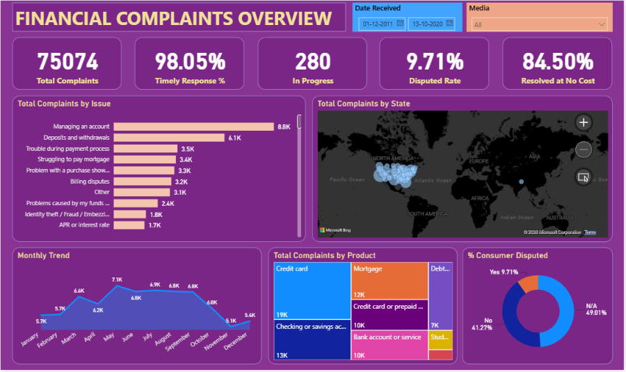

# Financial Complaints Analysis Dashboard | Power BI

## Project Overview

The **Financial Complaints Analysis Dashboard** is a data analytics project developed using Microsoft Power BI to analyze customer complaints related to financial products and services.

The project focuses on understanding complaint trends, monitoring resolution performance, identifying common customer issues, and evaluating dispute rates. The dashboard is designed to help financial institutions gain actionable insights into customer complaints and support data-driven decision-making.

## Business Problem

Financial institutions receive customer complaints across different products, issues, and geographical regions. Without effective reporting and analysis, identifying recurring problems, monitoring unresolved complaints, and evaluating customer service performance can be challenging.

This project aims to transform complaint data into meaningful visual insights that help stakeholders monitor key performance indicators and identify areas requiring improvement.

## Project Objectives

- Analyze the overall volume of customer complaints.
- Monitor the percentage of complaints receiving timely responses.
- Track complaints that remain unresolved or in progress.
- Evaluate the percentage of complaints escalated to disputes.
- Analyze complaints resolved without monetary compensation.
- Identify complaint patterns by issue, product, and state.
- Support better reporting and data-driven business decisions.

## Key Performance Indicators (KPIs)

The dashboard focuses on the following KPIs:

1. **Total Complaints:** Measures the overall volume of customer complaints.
2. **Timely Response Rate:** Tracks the percentage of complaints receiving a response within the defined timeframe.
3. **Complaints In Progress:** Monitors unresolved complaints currently being addressed.
4. **Consumer Disputed Rate:** Measures the percentage of complaints escalated to disputes.
5. **Resolved at No Cost Rate:** Measures the percentage of complaints resolved without monetary compensation.

## Dashboard Visualizations

The project is designed to explore complaint data through the following visualizations:

- **Complaints by Issue:** Identifies the most frequently reported customer problems.
- **Complaints by State:** Highlights geographical patterns in complaint volumes.
- **Complaints by Product:** Compares complaints across financial products and services.
- **Consumer Disputed Analysis:** Examines the proportion of complaints escalated to disputes.
- **KPI Summary:** Provides a high-level view of complaint volumes and resolution performance.

## Tools and Technologies

- **Microsoft Power BI:** Dashboard development and data visualization.
- **CSV Dataset:** Source data for complaint analysis.
- **Power BI Data Modeling and Measures:** Used as applicable to calculate KPIs and organize analytical metrics.
- **Data Analysis:** Examining complaint trends, resolution status, and business performance indicators.

## Project Files

| File | Description |
|---|---|
| `Financial_Complaints_Overview[1].pbix` | Power BI dashboard file |
| `Financial_Consumer_Complaints[1].csv` | Dataset used for analysis |
| `Problem_Statement[1].docx` | Project requirements and business objectives |

## Analytical Workflow

1. Understand the business problem and analytical requirements.
2. Load the financial complaints dataset into Power BI.
3. Review the dataset and prepare the data for analysis.
4. Develop relevant KPIs and measures.
5. Create visualizations to examine complaint trends and resolution status.
6. Organize the visuals into a dashboard for reporting and decision support.

## Business Value

This project demonstrates how data analytics and business intelligence tools can help organizations:

- Monitor customer complaint trends.
- Identify frequently reported issues and products requiring attention.
- Evaluate complaint response and resolution performance.
- Understand dispute patterns across the complaint dataset.
- Improve reporting and support evidence-based operational decisions.

## How to View the Project

1. Clone or download this repository.
2. Open `Financial_Complaints_Overview[1].pbix` using Microsoft Power BI Desktop.
3. If prompted, locate the CSV dataset and update the data source path.
4. Refresh the data if necessary and explore the dashboard.

## Skills Demonstrated

- Power BI dashboard development
- Data analysis and visualization
- KPI definition and reporting
- Business problem understanding
- Complaint trend analysis
- Data preparation and reporting workflow

## Author

**Chennoji Sai Vamshi**

Aspiring Data Analyst | Power BI | SQL | Excel | Python

- GitHub: https://github.com/Chennojivamshi
- LinkedIn: https://linkedin.com/in/chennoji-vamshi

---

*This project is intended for learning and portfolio demonstration. Findings and business conclusions should be based on the actual dashboard results and validated dataset.*
